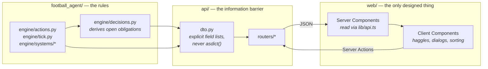

# Documentation

Durable notes on how this project is built and why. `docs/` holds the original
design and build plans; this folder records what was actually shipped.

| Document | What it covers |
| --- | --- |
| [features/investments.md](features/investments.md) | Fictional stock exchange, trading, fees, portfolio accounting and saves |
| [features/agency-expansion.md](features/agency-expansion.md) | Agency growth, careers, market/loans, persistence, UI and balance observations |
| [features/native-ios.md](features/native-ios.md) | Fully native iPhone game, Swift engine, offline saves and Xcode delivery |
| [ui/design-system.md](ui/design-system.md) | Colour, type, surfaces, motion, and the primitives every screen is built from |
| [ui/app-shell.md](ui/app-shell.md) | Desktop console, browser phone shell and native iPhone shell |
| [decisions-model.md](decisions-model.md) | Why "needs a decision" is derived from world state instead of the event feed |
| [changelog.md](changelog.md) | What changed in the UI overhaul, and the bugs it uncovered |

## The one-paragraph version

The Python engine in `football_agent/` remains authoritative for the CLI and web edition. A thin FastAPI service wraps it and speaks JSON; the Next.js app in `web/` holds no game rules. The iPhone edition is independently implemented in Swift so it can run offline, with `GameEngine` enforcing the same hidden-information boundary and progression loop behind a small native interface. See
[docs/ui_build_plan/01-architecture.md](../docs/ui_build_plan/01-architecture.md)
for the web architecture and [features/native-ios.md](features/native-ios.md) for the native boundary.

