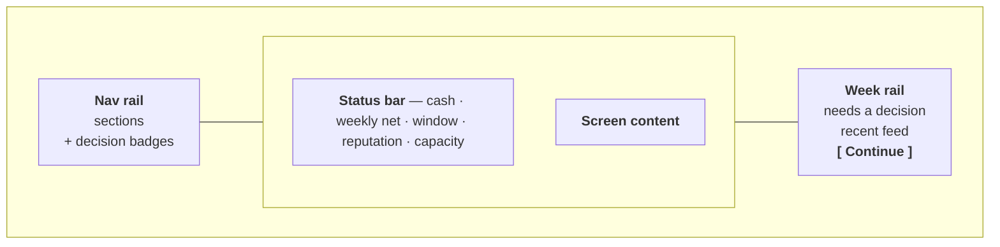

# The app shell

Updated 2026-09-26: `ios/FootballAgent.xcodeproj` now builds a fully native SwiftUI game rather than a WebKit wrapper. Its five persistent tabs are Office, Clients, Scouting, Market and More. A safe-area Continue bar sits above the tab bar, native sheets handle bounded negotiations, and locked systems remain visible with their exact progression requirement. The web shell described below remains the browser edition.

Updated 2026-09-19: the shell is iPhone-first below 768px. A safe-area-aware tab bar keeps Office, Clients, Scouting and More under a full-width Continue toolbar. More opens a bottom sheet with every secondary route. Phone layouts use one-column statistics, 44pt minimum actions, document scrolling and keyboard-aware chrome. The installable PWA and thin Xcode wrapper use this same UI and game flow.

Updated 2026-09-18: desktop rails use 184px navigation / 292px decisions at 1280–1535px, then 212px / 320px from 1536px. The status bar wraps to keep the calendar readable; capacity metrics appear from 1536px and remain available in the Office below that width. Agency record is always linked from desktop navigation. Stocks is available in desktop navigation and the More drawer (shortcut 9).

Updated 2026-09-10: `/` is the illustrated office; the prior dashboard lives at `/overview`. Agency, Careers, Market and World join the existing routes. Phone navigation uses Office, Clients, Market and More; every viewport has access to the same decisions drawer. Continue supports bounded event advancement with a shared synchronous guard. The original shell design below is retained as historical context; see [agency expansion](../features/agency-expansion.md).

Defined in `web/app/(game)/layout.tsx`. Three zones, present on every screen in
the game.

## Why rails

The previous shell was a cramped two-row header, a 1152px centred column, and a
Continue button floating over roughly 700px of empty black on a 1440px screen.
That emptiness was the single biggest reason it read as unfinished.

The rails fix four things at once:

1. **The dead space disappears.** The viewport is used.
2. **Continue gets a home.** It is anchored at the foot of the week rail rather
   than floating over nothing.
3. **You cannot press past a waiting club.** Continue is irreversible — one
   press is one week and there is no undo. With the open decisions permanently
   beside it, pressing it while a club waits on an answer is a choice rather
   than an accident.
4. **It reads as a console** rather than a document, which is the stated voice.

The cost is that the old Inbox screen became redundant, so `/` was repurposed as
an agency dashboard.

## The zones

### Nav rail (`components/shell/nav-rail.tsx`)

Nine sections, each with the CLI's number-key shortcut preserved and shown.
Vertical rather than a horizontal strip because it has to carry per-section
decision counts, and a strip has nowhere to put those without becoming noise.

The keyboard hint is drawn as a bordered key cap. An unstyled digit sitting
where a badge goes reads as "5 things need you", which is exactly the confusion
the badges exist to avoid.

`PhoneNav` keeps the three most frequent destinations and More in a fixed tab
bar. The More bottom sheet contains every secondary route. Both phone and
desktop navigation are landmarks with distinct labels (`Sections` and `Main`)
so assistive tech and tests can tell them apart.

### Status bar (`components/shell/status-bar.tsx`)

Everything you should never have to go looking for: cash beside weekly net (the
game's central pressure), the window state and its countdown, reputation, and
your client and scout capacity against their caps.

### Week rail (`components/shell/week-rail.tsx`)

Open decisions at the top, the chronological feed below, Continue anchored at
the foot with a count of what is still open. See
[decisions-model.md](../decisions-model.md) for how that list is built.

## The Continue button

`components/continue-button.tsx` renders in two positions depending on the
viewport — anchored in the rail on wide screens, floating bottom-right when the
rail is hidden. Both instances exist in the DOM and only one is visible.

Because of that it listens for a `fa:continue` window event rather than exposing
an `id` for the keyboard handler to click; the handler that responds checks its
own visibility first. An id-based handler would fire the hidden one.

## Responsive behaviour

Desktop-first, degrading rather than reimagining.

| Width | Nav | Week rail | Continue | Tables |
| --- | --- | --- | --- | --- |
| ≥ 1280px | Rail with labels | Visible | In the rail | Full tables |
| 768–1279px | Icon-only rail | Hidden; decisions move into the dashboard | Floating | Full tables |
| < 768px | Fixed four-tab bar | Hidden; decisions open from Review | Full-width toolbar above tabs | One-column cards and document scrolling |

The decisions panel on the dashboard is `xl:hidden` — it is a duplicate of the
rail on wide screens, and the *only* place decisions appear on narrow ones.

## Keyboard

| Key | Action |
| --- | --- |
| `C` | Continue — one week |
| `1`–`9` | Jump to a section |
| `Esc` | Close a dialog |

Ignored while typing in a field or while a dialog is open; dialogs own their own
keys.
